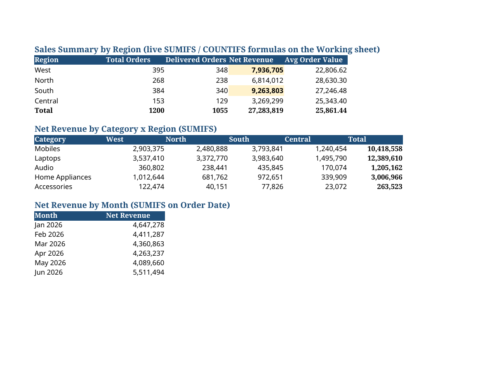
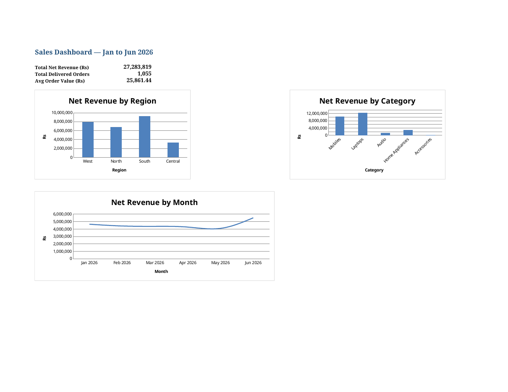

# Excel Sales Analysis

A sales analysis of an Indian e-commerce store, done fully in Excel — VLOOKUP, IF, SUMIFS, COUNTIFS, a region summary, and a dashboard with charts. I built this to show my Excel skills for Data Analyst roles: the workbook runs on formulas, not typed-in answers, so if the raw data changes, every number updates on its own.

## Dataset

Synthetic practice data that I generated for this project (it is not a real company's data). 1,200 orders from Jan to Jun 2026 with columns: Order ID, Order Date, Customer Name, City, Region, Category, Product, Quantity and Status (Delivered / Cancelled / Returned). The raw data deliberately has no prices — prices sit in a separate price list, so the workbook has to look them up, just like real work. The same raw data is in `data/sales_raw.csv`.

## What each sheet does

- **Raw Data** — the 1,200 orders as received. Nothing is calculated here.
- **Price List** — one row per product (23 products) with its category and unit price. This is the lookup table.
- **Working** — the raw data plus three formula columns: Unit Price (VLOOKUP from Price List), Revenue (Quantity × Unit Price), and Net Revenue (0 for cancelled/returned orders, using IF). Net Revenue has data bars so big orders stand out.
- **Region Summary** — a pivot-style summary built with live SUMIFS/COUNTIFS formulas on the Working sheet: orders, delivered orders, net revenue and average order value per region, a Category × Region revenue matrix, and a month-wise revenue table. (Honest note: this is a formula-built summary, not a native Excel pivot table — the file was made with a script, and the formulas do the same job and stay live.)
- **Dashboard** — the three headline numbers (Total Net Revenue, Total Delivered Orders, Avg Order Value, all live formulas linked to the summary) and three charts: Net Revenue by Region, Net Revenue by Category, and Net Revenue by Month.

## Formulas I used

- **VLOOKUP** — pulls each product's unit price from the Price List into the Working sheet. Prices stay in one place, so a price change means editing one table only.
- **IF (with OR)** — sets Net Revenue to 0 when an order is Cancelled or Returned, so failed orders never inflate the revenue.
- **SUMIFS** — adds up net revenue for one region, one category-region pair, or one month, using several conditions at once.
- **COUNTIFS** — counts total and delivered orders per region with the same kind of conditions.
- **Division for averages** — Avg Order Value = Net Revenue ÷ Delivered Orders, guarded with IF so an empty group shows 0 instead of an error.

## Region Summary

The summary table, the Category × Region matrix and the month-wise revenue — all of it is formulas on the Working sheet. Regions above the average revenue (West and South) are highlighted automatically by conditional formatting.

## Dashboard

The dashboard reads everything from the Region Summary sheet, so it never goes stale: region and category bar charts, the month trend line, and the three headline numbers on top.

## What I found

- **South is my biggest region.** It brought in Rs 92,63,803 — about 34% of the total net revenue of Rs 2,72,83,819 — while Central gave only Rs 32,69,299 (about 12%). If I had to pick where to push marketing first, it would be Central, because the gap is large.
- **Laptops and Mobiles carry the business.** Laptops alone are Rs 1,23,89,610 (about 45% of net revenue), and Laptops + Mobiles together are about 84%. Accessories sold in good numbers but made only Rs 2,63,523 (about 1%) — the ticket size is just too small to matter much.
- **Cancelled and returned orders quietly eat a lot.** 145 of 1,200 orders (about 12%) were cancelled or returned, and they wiped out Rs 38,73,884 of revenue — roughly 12% of what the store could have earned. Cutting returns even a little would be worth more than a small sales push.

## What I learned

Writing the summary with SUMIFS instead of a pivot table taught me how a pivot actually works inside — group, filter, then add. I also learned to keep prices in one lookup table instead of typing them into the data; it makes the whole workbook easier to trust and update.

## Tools

Microsoft Excel formulas (VLOOKUP, IF, SUMIFS, COUNTIFS), charts and conditional formatting. The workbook was generated with Python (openpyxl) and every total was cross-checked against an independent Python calculation — they match to the rupee.
